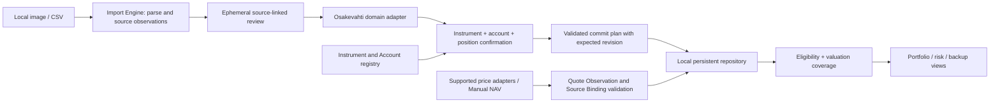

# Proposed boundaries, safe migration and ordered PR roadmap

Proposal for Issue #77 only. This Phase 1 change implements none of this model. Existing PR #76 remains intact. Every implementation/release step needs its own review; publication and real-user data migration need explicit user approval.

## Boundaries and ownership

| Module / entity | Owns | Must not own |
|---|---|---|
| Instrument | Stable internal UUID, name, type, share class, denomination currency, optional independently verified ISIN; optional reviewed listing references (ticker + MIC + quote currency + provider identifiers) | Quantity, account identity, acquisition cost, latest-price mutation, fuzzy automatic source approval |
| Portfolio Position | Position UUID, accountId + instrumentId, total quantity decimal text, optional per-unit acquisition cost + currency + provenance/known flag; explicit aggregation policy | Invented ticker, source catalog, OCR parser, account inferred from bank name |
| Account | Account UUID, broker/provider label, user label, confirmed type or unknown, verification state; legacy raw account preserved | Fund identity, automatic AOT/OST conversion, bank account numbers unless separately justified |
| Quote Observation | Immutable observation ID, bindingId/instrumentId, decimal price, currency, economic role (`fund-nav`/`market-price`), exact `asOfDate` or null, original date text, observedAt/fetchedAt, source evidence and status | Position quantity/cost, treating fetch time as NAV year, implicitly replacing the last good observation |
| Price Source Binding | Binding UUID/version, instrumentId, supported provider adapter ID, opaque provider instrument/class identifier, expected currency, reviewed identity evidence, enabled/disabled/manual-only status | Arbitrary scraping URL, dynamic code, fuzzy name as identity proof, user price marked provider-verified |
| Import Engine Adapter | Maps one pinned evidence/candidate contract into Osakevahti fields; checks financial roles and quantity semantics; retains raw/corrected source references during review | Second parser, registry writes, quote fetches, Palkka domain rules, granting `canPersist:true` |
| User Review and Confirmation | Per-field correction, source display, instrument/account choice, change diff, explicit snapshot-vs-trade semantics, final confirmation tied to draft/repository revision | Automatically teaching identities from one confirmation; silent inferred year/cost; committing stale confirmation |
| Persistent Storage | Schema validation, immutable migration input, versioned snapshots, transactional commit, revision conflict detection, backup/restore | OCR semantics, market-provider selection, financial defaults or guessed repairs |
| Valuation policy | Last eligible quote selection, quantity × unit price, explicit FX provenance/date, completeness/estimate status, cost/P&L availability | Zero or acquisition-cost substitution for missing NAV, presenting partial aggregates as exact |

Use decimal strings at interfaces for quantity, money and rates; preserve original displayed precision separately. Arithmetic must have explicit precision and rounding policy. Legacy JS Number data has already lost some original precision; migration must not claim to reconstruct it.

Suggested envelopes (field definitions, not invented financial data):

- `Instrument {id, type, displayName, shareClass?, denominationCurrency?, identifiers: [{kind, value, verification, evidenceRef}], listings: [], legacyAliases: []}`.
- `Position {id, instrumentId, accountId, quantityDecimal, quantityEvidence, acquisitionCost: {perUnitDecimal|null, currency|null, status, evidenceRef}, legacyRecordRef}`.
- `Account {id, broker, label, type, confirmation, legacyLabels: []}`.
- `QuoteObservation {id, instrumentId, bindingId, role, priceDecimal, currency, asOfDate|null, reportedDateText, observedAt, fetchedAt, sourceKind, evidenceRef, identityStatus, validationStatus}`.
- `SourceBinding {id, version, instrumentId, adapterId, providerInstrumentId, shareClass, currency, confirmation, evidenceRef, enabled}`.
- `PortfolioEnvelope {schemaVersion, revision, migrationId, instruments, accounts, positions, bindings, quoteObservations, selectedQuoteIds, settings}`.

An ISIN checksum proves syntax, not real identity. A ticker is listing-scoped, never the application primary key. Same-name funds or multiple share classes must not collapse. Multiple accounts keep separate positions even when instrumentId matches. Until an identity is independently established, retain separate provisional instruments; merging them is an explicit reversible user operation, not an import side effect.

Snapshot import means replacing the confirmed position's total quantity, not adding trades. A transaction import requires a separately typed contract; never infer one from another. Missing cost remains unknown, so valuation may be available while P&L is unavailable. An acquisition-cost edit cannot modify quantity, NAV or its source/date.

## Quote eligibility and manual fallback

Validate supported provider, binding revision, class/instrument identity, exact expected currency, finite positive price, economic role and date policy before making an observation eligible. A provider adapter that cannot prove those fields must report insufficient evidence. Contradictions override positive numeric checks. Do not synthesize currency from a URL or silently use missing-currency feeds as verified.

Keep immutable observations and retain the last good quote when a fetch times out, returns HTTP failure, malformed data, old date or identity conflict. Track the latest attempt separately from the selected observation. Statuses must distinguish `unlinked`, `fetch-failed`, `invalid-source`, `identity-conflict`, `currency-conflict`, `yearless`, `date-missing`, `stale`, `manual` and `eligible`. Persist fetchedAt and asOfDate separately. Completeness must propagate to totals, allocation, risk and P&L; a mixed-date estimate must be labelled as such and expose per-position reasons.

Manual NAV is a first-class path for any unpriced fund: user enters positive decimal NAV, exact full valuation date, currency and source description/reference, confirms share class and sees **KÄSIN**. Store sourceKind=`manual` and confirmation provenance, never `provider-verified`. Apply the same stale-date policy and show age based on the entered valuation date. If date/currency is unknown, allow an ephemeral incomplete draft, not an eligible quote. No automatic estimate of the year. Editing cost and manual NAV uses separate controls and separate commands.

New instrument registration does not require source code: create a provisional UUID-backed Instrument from user-reviewed name/type/class/currency and a separate Position/Account association. Provider capabilities come from a reviewed adapter registry; the user chooses only a supported provider and validated opaque instrument ID. A new provider implementation still requires a reviewed code change. No free automated source available means manual-only, honestly labelled. A source reference URL can be displayed as provenance without being fetched; arbitrary network destinations and scraper scripts are not user input capabilities.

## Reusing Import Engine without copying parsing again

Current bridge uses four modules from PR #33, and application CSV parsing runs independently of its audit. PR #68 offers `createOsakevahtiFundSnapshotReview`, `createOsakevahtiReview`, `createDomainReview`, `createReviewDraft`, `reviewFieldSources`, explicit correction and cancellation. Its fund adapter preserves decimal text/source IDs and NAV-cost collision checks, with `canPersist:false`, unverified identity and ephemeral source evidence. This is a suitable candidate boundary, **not a claim that PR #68 is independently approved or production-ready**.

Future integration must pin a reviewed Engine commit/package and test its contracts before replacing one existing input path. Use the Engine's parser and evidence extraction once; do not reconstruct source rows from already interpreted values or independently reparse CSV to obtain a different result. A domain adapter adds explicit Osakevahti account/position intent and source binding, not another OCR name matcher. The app commit gate consumes a reviewed diff plus current storage revision and remains separate from Engine review.

Share the generic evidence envelope, raw-vs-correction provenance, cancellation, duplicate source-ID checks and review mechanics with Palkka. Keep payroll fields (pay period, year-to-date values, tax roles, payroll history) and validation in Palkka's adapter. Do not share holdings-required fields, account matching, NAV rules or position persistence with payroll. No Palkka code/history/backup changes are proposed in this PR. Shared core must remain storage- and market-service-free.

Raw OCR strings and images belong to a short-lived review draft, not a reusable learning profile or automatic backup. After confirmation, retain the minimum user-approved financial provenance (source kind, review time, document hash/reference, field-role/source references as appropriate); a hash is provenance, not validation. Optional local source retention needs a separate explicit choice, retention policy and backup warning. Never send personal screenshots to provider lookup; only explicitly reviewed identity search terms may leave the device.

## Safe migration plan

1. **Inventory without writes.** Detect v1 envelope, duplicate/missing IDs, number types, account labels, currency ambiguity, synthetic symbol aliases, source keys and date evidence. Save a local report and show counts/issues. No startup mutation of financial fields. Preserve unknown legacy properties in an extension payload.
2. **Rollback material first.** Offer/download the existing JSON backup; create a local untouched v1 snapshot plus checksum before a user-approved migration. Handle quota failure before writing any candidate. Never copy API credentials into exported backup.
3. **Pure candidate transformation.** Preserve existing position IDs where unique. For absent IDs generate UUIDs once into a migration plan; repeated execution uses that plan/migrationId, not fresh random IDs. Create account/instrument IDs from explicit mappings; do not deduplicate by fuzzy names or bank names. Keep same-name accounts separate until the user resolves them. Preserve legacy symbols as aliases, not invented listing tickers.
4. **Preserve financial evidence.** Copy quantity/cost exactly as represented, retaining missing-vs-zero provenance. Existing full valid NAV dates may retain their source status; yearless/invalid dates become `asOfDate:null` with original text. Legacy mapping and current price do not become a verified binding merely because they already existed. Quarantine contradictions without deleting holdings. Never infer missing price, year, ISIN, exchange or cost.
5. **Validate/reconcile.** Schema/type/ID uniqueness, all references resolved or explicitly quarantined, currencies supported, per-account quantities/cost unchanged, no source/cost/NAV role substitution. Compare before/after values using the same eligible quotes; differences caused solely by explicit unknown/estimate policy must be displayed, not hidden. A blocked migration leaves v1 byte-identical.
6. **User-visible diff and one commit.** User approves the exact candidate + base revision. Prefer one IndexedDB transaction for envelope and migration receipt; if remaining on localStorage, write a single complete versioned envelope under a NEW key and verify readback before switching a version pointer. A multi-key write is not atomic; retain an explicit recovery protocol and validate both generation/pointer on boot. Do not dual-write legacy mutable holdings.
7. **Concurrency/recovery.** Refuse stale plan revisions; refresh and confirmation cannot silently race. Test crash between staging and activation, quota errors, corrupted candidate, two tabs and repeated migration. Keep previous generation usable until success, and rollback only with an explicit choice. If new data has been added after migration, export v2 before rollback; never silently restore stale v1.
8. **Restore uses the same pipeline.** Validate entire backup, inspect schema version and unknown fields, produce migration/replacement preview, explicitly confirm, then commit atomically. Restore failure leaves both memory and disk unchanged. A backup without IDs must either be rejected with instructions or receive stable IDs through the reviewed migration, not be silently accepted unusably.

Required migration tests in future PR: anonymized historical shapes (synthetic here), no-ID/duplicate-ID accounts and positions, repeated migration, decimal strings and legacy numbers, unsupported currency, yearless dates, malformed envelope, wrong binding, interrupted write, quota failure, concurrent tabs, downgrade/rollback. Phase 1 tests current migration idempotence and selected restore failures, not the future migration algorithm.

## Ordered implementation PRs (not started)

1. **Storage/restore safety:** pure candidate validation and atomic adoption; stable legacy-ID planning; explicit currency validation; address R77-03/04/06. Keep old storage schema initially. Gate: negative restore, quota and generic-import rollback tests pass without modifying old oracles.
2. **Binding identity and quote contract:** prevent wrong class/name binding and contradictory feed identity; separate fetch attempt from retained quote. Explicitly reject unsupported proof. Gate: R77-01/05 and existing wrong-currency/control tests.
3. **Valuation eligibility:** one completeness/estimate function used by aggregate and details; retain last good quote; distinguish missing/yearless/stale/manual. Gate: R77-02 plus price/cost/quantity isolation.
4. **Versioned model behind compatibility adapter:** Instrument/Account/Position/Observation/Binding separation with pure migration preview, backward-readable backup and rollback. No automatic identity merge. Gate: migration/backup invariants and cross-account tests.
5. **One Engine-backed import path:** pin independently reviewed Engine contract; integrate source-linked review for one fund layout, replace that parser path, retain other paths behind explicit labels until migrated. Gate: real PNG and CSV evidence, cancel/revision/source-ID tests, no persistent raw OCR or Palkka changes.
6. **General onboarding + manual NAV:** add provisional instruments without source-code edits, opt-in validated provider bindings, exact dated/manual provenance. Gate: unseen fictional funds and unsupported-provider fallback; no arbitrary URL fetch.
7. **Feed/deployment separation and reproducible QA:** isolate provider acquisition from Pages deployment and rerun artifact names; lock test dependencies and synchronize legacy test refresh races. Deterministic safety tests gate code; live smoke records transport/provider availability separately. Never suppress real contract failures as network noise.

Each PR stays Draft until independent QA. Later Alpha rollout requires a local backup and real Android acceptance with user-approved source images. Main changes, LAB publication and production deployment remain separate explicit decisions.
